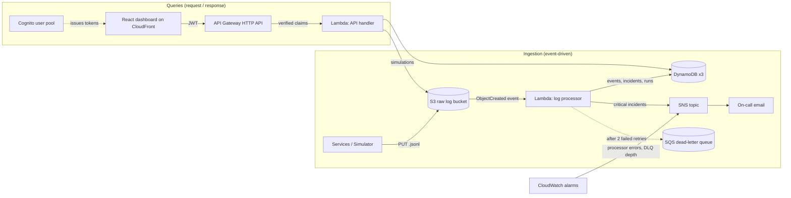

# CloudLog

**Serverless error-log detection on AWS.** Services drop JSON Lines log files into Amazon S3. Each file
triggers a Lambda function that validates every line, masks personal data, stores the events in
DynamoDB and runs detection rules. Repeated failures are grouped into one incident, recurring errors are
escalated, and anything critical pages on-call through Amazon SNS. A React dashboard (behind API Gateway
and Cognito) shows the pipeline working in real time and lets analysts acknowledge and resolve incidents.

Errors are simulated: the dashboard's **Simulator** writes realistic failure scenarios (a database outage, a
brute-force login attack, an IoT cold-chain fault, a malformed file...) to S3 so every cloud component can
be seen doing its job.

The whole stack also runs **offline** in an emulator, so it can be demonstrated without an AWS account.

---

## Architecture



| Step | What happens | Where in the code |
| --- | --- | --- |
| 1 | A `.jsonl` file lands in S3 (from a service, the CLI, or the simulator) | [backend/handlers/api.py](backend/handlers/api.py) `simulate` |
| 2 | S3 invokes the processor Lambda asynchronously | [infrastructure/terraform/s3.tf](infrastructure/terraform/s3.tf) |
| 3 | Each line is validated, normalised and PII-masked; one bad line never aborts the file | [backend/analyzer/parser.py](backend/analyzer/parser.py), [privacy.py](backend/analyzer/privacy.py) |
| 4 | Events are batch-written to DynamoDB with a 7-day TTL | [backend/storage/events.py](backend/storage/events.py) |
| 5 | Detection rules turn lines into detections | [backend/analyzer/detector.py](backend/analyzer/detector.py) |
| 6 | Detections open, update, escalate or reopen incidents with atomic, idempotent updates | [backend/storage/incidents.py](backend/storage/incidents.py) |
| 7 | Critical incidents are published to SNS | [backend/alerts/sns.py](backend/alerts/sns.py) |
| 8 | A pipeline-run record (counts, rejections, per-stage timings) is saved for the dashboard trace | [backend/handlers/processor.py](backend/handlers/processor.py) |
| 9 | The dashboard queries everything through API Gateway; statistics use MapReduce | [backend/analytics/mapreduce.py](backend/analytics/mapreduce.py) |

---

## Run it offline in two minutes

No AWS account needed. S3, DynamoDB and SNS are emulated in memory with [moto](https://github.com/getmoto/moto);
the emulator invokes the **same Lambda handler code** that runs in AWS.

**Option A: Docker or Podman (one command)**

```bash
docker compose up --build        # or: podman compose up --build
```

Open <http://localhost:8000>.

**Option B: Python + Node (for development)**

```bash
python3 -m venv .venv && .venv/bin/pip install -r requirements-dev.txt
.venv/bin/python -m backend.local.emulator --seed --traffic 20     # API on :8000

cd frontend && npm install && npm run dev                           # dashboard on :5173
```

| Emulator flag | Effect |
| --- | --- |
| `--seed` | Loads a few scenarios at start-up so the dashboard isn't empty |
| `--traffic 20` | Uploads normal traffic every ~20 s so the charts move |
| `--delay 0.8` | Emulated S3-to-Lambda trigger latency, in seconds |

Sign in by choosing a role. **Analyst** is the best role for a demo; **Viewer** shows the API refusing changes.

---

## Five-minute demo script

1. **Sign in as Analyst.** Point out the role chip: permissions come from Cognito groups and are enforced by the API.
2. **Overview.** The pipeline map is the architecture, live. Each node shows what happened to the last file.
3. **Simulator → Database outage → Run.** Follow the file: uploaded to S3, Lambda invoked, lines stored,
   rules applied, SNS alert published. Switch to Overview and the packet travels the map; the critical
   path turns red.
4. **Incidents.** Seven log lines became four incidents, not seven tickets. Open the critical one: the
   timeline shows *opened → alerted*. Acknowledge it with a note, then resolve it.
5. **Simulator → Payment timeouts → Run twice.** The second run pushes the incident past five occurrences
   and it **escalates** to CRITICAL with a new alert. Card numbers and emails in the logs are masked.
6. **Run Database outage again** after resolving: the incident **reopens** (a regression) and keeps its history.
7. **Malformed log file.** Five broken lines are rejected with reasons; the valid lines are still stored.
8. **Pipeline page.** Every Lambda invocation with per-stage timing. Expand a row.
9. **Sign out, sign in as Viewer**, try to resolve: refused with 403 by the API, not just hidden in the UI.

---

## Features

### Detection rules

| Rule | Fires when | Result |
| --- | --- | --- |
| Critical log line | Any `CRITICAL` line | Critical incident + SNS alert |
| Error log line | Any `ERROR` line | Error incident; repeats join it |
| Brute-force login | 5+ failed logins from one IP in a file | Critical **security** incident + alert |
| Warning burst | The same warning 3+ times in a file | Error incident (degradation) |
| Recurring error escalation | An error incident reaches 5 occurrences in total | Escalated to CRITICAL + alert |

Thresholds live in [backend/config.py](backend/config.py).

### Grouping and the incident lifecycle

Every line gets a **fingerprint**: a hash of the service plus its error code (or, without one, the message with
numbers and IDs stripped, so `timed out after 5012ms` and `timed out after 5390ms` match). One fingerprint is
one incident.

```
OPEN ──acknowledge──► ACKNOWLEDGED ──resolve──► RESOLVED
  └───────────────────resolve──────────────────────┘    └─ same error again ─► OPEN (reopened)
```

Every change is appended to the incident's timeline with who did it and when. The dashboard reports
mean time to acknowledge (MTTA) and mean time to resolve (MTTR).

### Reliability

- **Idempotent processing.** S3 and Lambda deliver *at least once*. Event IDs are a hash of
  `bucket:key:line`, so a retry overwrites rather than duplicates. Incidents record which files they have
  counted, so a retried file never inflates the occurrence count.
- **Atomic counters.** Occurrences are incremented with DynamoDB `ADD` under a condition expression, so
  concurrent Lambdas can't lose updates. State transitions are conditional too, so an incident can't be
  acknowledged twice (409).
- **Retries and a dead-letter queue.** Lambda retries a failed file twice, then parks the event in SQS.
- **Monitoring the monitor.** CloudWatch alarms on processor errors and on DLQ depth publish to the same SNS topic.

### Security and privacy

- Cognito sign-in; API Gateway verifies the JWT before any code runs; role permissions are checked in
  [backend/handlers/auth.py](backend/handlers/auth.py).
- Least-privilege IAM: each Lambda gets exactly the DynamoDB/S3/SNS actions it calls, nothing more
  (the API can only write under `raw-logs/simulations/`).
- Emails, card numbers and IP addresses in log messages are masked **before** storage; stored IPs keep
  only the subnet. Security incidents keep the full attacker IP because responders need it.
- S3 and DynamoDB encrypted at rest; the bucket blocks public access; the dashboard bucket is private
  behind CloudFront Origin Access Control; API throttling at the gateway.
- The emulator's role header is honoured only when `CLOUDLOG_LOCAL_MODE=1`.

---

## How this maps to the PAMCA601 syllabus

| Module | Topic | Where it is in CloudLog |
| --- | --- | --- |
| 1 | Service models, deployment model | FaaS (Lambda), managed NoSQL and storage (DynamoDB, S3) in a public cloud; see [docs/architecture.md](docs/architecture.md) |
| 1 | Virtualization | Lambda runs each function in a Firecracker micro-VM; the emulator runs in a container |
| 2 | Resource pooling, provisioning, scaling | On-demand DynamoDB, Lambda scales out per S3 event, no capacity to plan |
| 2 | Multi-tenancy | One table holds every service's logs, partitioned by `service`; per-day GSI for the shared feed |
| 2 | Zero-downtime design | Async retries + DLQ, idempotent writes, point-in-time recovery on incidents |
| 2 | Load control, CDN | API Gateway throttling; dashboard served from CloudFront edge locations |
| 2 | Storage optimisation | DynamoDB TTL, S3 lifecycle to Infrequent Access then expiry |
| 3 | MapReduce | Dashboard statistics: [backend/analytics/mapreduce.py](backend/analytics/mapreduce.py) |
| 3 | Microservices, serverless, event processing | Two independent Lambdas joined by S3 events, not calls |
| 3 | Infrastructure as Code (Terraform) | [infrastructure/terraform/](infrastructure/terraform/) defines every resource |
| 3 | Git, CI, automated testing | [.github/workflows/ci.yml](.github/workflows/ci.yml): lint, 80 unit tests with emulated AWS, Terraform validate, image build |
| 3 | Containers and orchestration | [Dockerfile](Dockerfile), [docker-compose.yml](docker-compose.yml), [deploy/k8s/cloudlog.yaml](deploy/k8s/cloudlog.yaml) |
| 4 | Threat detection | Brute-force rule, security incident category |
| 4 | Network, host, application security | Gateway JWT check, private buckets + OAC, IAM least privilege, input validation |
| 4 | Identity and access management | Cognito groups → Admin / Analyst / Viewer permissions |
| 4 | Zero trust | Every request authenticated at the gateway and authorised again in the Lambda |
| 4 | Privacy in the cloud | PII masking before storage, IP minimisation, TTL-based deletion |
| 5 | Edge computing and IoT | IoT cold-chain scenario: an edge gateway forwarding sensor telemetry to the cloud pipeline |

---

## Deploy to your own AWS account

Everything below works from a fresh `git clone`. It creates the resources in **your** AWS account; nothing
is shared with whoever published the repo. Allow about 20 minutes the first time.

The steps use an **AWS CLI named profile**: a saved set of credentials with a name. The examples call it
`cloudlog`; any name works (the original author's is called `terraform`), as long as you use the same name
everywhere.

### Step 1. Install the tools

| Tool | Check with | Get it |
| --- | --- | --- |
| AWS CLI v2 | `aws --version` | <https://docs.aws.amazon.com/cli/latest/userguide/getting-started-install.html> |
| Terraform 1.5+ | `terraform -version` | <https://developer.hashicorp.com/terraform/install> |
| Node.js 22 | `node --version` | <https://nodejs.org> |
| Python 3.11+ | `python3 --version` | <https://www.python.org/downloads/> |
| Git | `git --version` | <https://git-scm.com/downloads> |

You also need an AWS account: <https://aws.amazon.com/free>.

### Step 2. Create an access key in the AWS console

Don't use the account's root user for this. Create a separate IAM user:

1. Sign in to the AWS console and open **IAM** → **Users** → **Create user**.
2. Name it, for example, `cloudlog-deployer`. Leave console access unticked. Click **Next**.
3. Choose **Attach policies directly**, tick **AdministratorAccess**, click **Next**, then **Create user**.
   (Terraform creates IAM roles, Lambda, DynamoDB, S3, SNS, SQS, API Gateway, Cognito, CloudWatch and
   CloudFront, so it needs broad rights. Delete this user when the coursework is over.)
4. Open the new user → **Security credentials** → **Create access key**.
5. Choose **Command Line Interface (CLI)**, tick the confirmation, **Next**, **Create access key**.
6. Copy the **Access key ID** and **Secret access key**. The secret is shown only once.

Never commit these keys to git or paste them into a file in this repository.

### Step 3. Save the key as a named profile

```bash
aws configure --profile cloudlog
```

Answer the four prompts:

```
AWS Access Key ID [None]:      <paste the access key ID>
AWS Secret Access Key [None]:  <paste the secret>
Default region name [None]:    ap-south-1
Default output format [None]:  json
```

This writes the key to `~/.aws/credentials` and the region to `~/.aws/config`, outside the project.

Check that the profile works:

```bash
aws sts get-caller-identity --profile cloudlog
```

It should print your 12-digit account ID and the `cloudlog-deployer` user. If it prints an error, fix it
now; nothing later will work without this.

> Using AWS IAM Identity Center (SSO) instead of access keys? Run `aws configure sso --profile cloudlog`
> once, and `aws sso login --profile cloudlog` whenever the session expires. Everything else is the same.

### Step 4. Tell your terminal to use the profile

Terraform, the AWS CLI and the Python scripts all read the `AWS_PROFILE` environment variable. Set it **once
per terminal window**, in the syntax of your shell:

| Shell | Command |
| --- | --- |
| bash, zsh (Linux, macOS, Git Bash, WSL) | `export AWS_PROFILE=cloudlog` |
| fish | `set -x AWS_PROFILE cloudlog` |
| PowerShell (Windows) | `$env:AWS_PROFILE = "cloudlog"` |

Confirm it took effect. With no `--profile` flag this time:

```bash
aws sts get-caller-identity
```

A new terminal window starts without the variable, so set it again there. If you would rather not set it,
put it in front of each command instead, for example `AWS_PROFILE=cloudlog terraform apply`. For Terraform
only, `-var aws_profile=cloudlog` also works.

To make it permanent, so every new terminal already has it:

| Shell | Make permanent | Undo |
| --- | --- | --- |
| bash | add `export AWS_PROFILE=cloudlog` to `~/.bashrc` | delete that line |
| zsh | add `export AWS_PROFILE=cloudlog` to `~/.zshrc` | delete that line |
| fish | `set -Ux AWS_PROFILE cloudlog` | `set -Ue AWS_PROFILE` |
| PowerShell | `setx AWS_PROFILE cloudlog` (applies to windows opened afterwards) | `[Environment]::SetEnvironmentVariable("AWS_PROFILE", $null, "User")` |

Only do this if it is the only AWS profile you use: every AWS command on your machine will then use it.

**Which commands need the profile:**

| Needs AWS credentials (set `AWS_PROFILE` first) | Doesn't need them |
| --- | --- |
| `terraform init`, `plan`, `apply`, `output`, `destroy` | `npm run dev`, `npm run dev:aws`, `npm run build` |
| `scripts/deploy_dashboard.sh` | the offline emulator |
| `scripts/test_e2e_aws.py`, `scripts/upload_logs.py` | `pytest` (uses emulated AWS) |
| any `aws ...` command | |

The dashboard itself never uses your profile. In the browser you sign in through Cognito instead.

### Step 5. Get the code and install dependencies

```bash
git clone https://github.com/FarazAkhtarKhan/CloudLog.git
cd CloudLog
python3 -m venv .venv
.venv/bin/pip install -r requirements-dev.txt
npm --prefix frontend install
```

On Windows PowerShell the virtual-environment path is `.venv\Scripts\pip` instead of `.venv/bin/pip`.

### Step 6. Create the infrastructure

In a terminal where `AWS_PROFILE` is set:

```bash
cd infrastructure/terraform
terraform init        # downloads the AWS provider; run once per clone
terraform plan        # preview: about 57 resources to add, 0 to change, 0 to destroy
terraform apply       # shows the plan again; type yes
```

`apply` takes about 5 minutes; most of it is CloudFront. It ends with `Apply complete!` and a list of
outputs (API URL, bucket names and so on).

Optional settings. Pass the same ones to `plan`, `apply` **and** `destroy`:

| Option | Effect |
| --- | --- |
| `-var alert_email=you@example.com` | Critical alerts are emailed to you. AWS sends a confirmation email first; click its link |
| `-var aws_region=us-east-1` | Deploy to another region (default `ap-south-1`, Mumbai) |
| `-var enable_dashboard_hosting=false` | Skip CloudFront and only run the dashboard from localhost |

Terraform records what it created in `infrastructure/terraform/terraform.tfstate`. Keep that file: it is
how `destroy` knows what to delete. It is git-ignored because it contains secrets, so don't commit it.

### Step 7. Run the dashboard against AWS

The dashboard has two modes. `npm run dev` always uses the offline emulator; `npm run dev:aws` uses your
AWS stack, with settings from `frontend/.env.aws.local`. Switching never needs a file edit.

Still in `infrastructure/terraform`, write the settings file, then start the dashboard:

```bash
terraform output -raw frontend_env > ../../frontend/.env.aws.local
cd ../../frontend
npm run dev:aws
```

Open <http://localhost:5173>. The bottom-left corner should say **AWS ap-south-1**. If it says
**Offline emulator**, you ran `npm run dev` instead of `npm run dev:aws`.

**Or publish it to the internet** on CloudFront. From the project root, with `AWS_PROFILE` set:

```bash
./scripts/deploy_dashboard.sh     # builds, uploads to S3, prints the https://....cloudfront.net URL
```

This is a bash script: on Windows, run it from Git Bash or WSL. A brand-new CloudFront URL can take a few
minutes to start answering.

Sign in with a demo account that Terraform created:

| Role | Email | Password |
| --- | --- | --- |
| Admin | `admin@cloudlog.local` | `CloudLogAdmin#2026` |
| Analyst | `analyst@cloudlog.local` | `CloudLogAnalyst#2026` |
| Viewer | `viewer@cloudlog.local` | `CloudLogViewer#2026` |

These passwords are public because they are in this repository. They are fine for a demo, but destroy the
stack afterwards, or change them in `infrastructure/terraform/cognito.tf` before applying.

### Step 8. Check that it works

From the project root, with `AWS_PROFILE` set:

```bash
.venv/bin/python scripts/test_e2e_aws.py
```

It signs in to Cognito, runs the database-outage scenario through API Gateway → S3 → Lambda, waits for the
processor, and checks incidents, the SNS alert and Viewer permissions. Every line should say `PASS`.

To send a log file straight to S3, the way a real service would (no dashboard or API involved):

```bash
.venv/bin/python scripts/upload_logs.py --scenario brute-force
```

Watch it arrive on the dashboard's **Pipeline** page within a second or two. In the AWS console you can also
see the work being done: **CloudWatch** → Log groups → `/aws/lambda/cloudlog-processor-dev`, and
**DynamoDB** → Tables → `cloudlog_incidents`.

### Step 9. After pulling new code

Run `terraform apply` again, with `AWS_PROFILE` set. Terraform repackages the Lambda code and updates only
what changed. If you publish the dashboard, run `./scripts/deploy_dashboard.sh` again too.

### Step 10. Delete everything when you're finished

In a terminal where `AWS_PROFILE` is set, with the same `-var` options you used for `apply`:

```bash
cd infrastructure/terraform
terraform destroy     # type yes; 5-10 minutes because CloudFront must be disabled first
```

Don't cancel it partway. It ends with `Destroy complete!` and the number of resources removed. At demo volumes the
stack fits in the AWS Free Tier and costs almost nothing while idle, but destroying it is the only way to be
certain. Afterwards, delete the `cloudlog-deployer` IAM user if you no longer need it.

### Common problems

| Symptom | Cause and fix |
| --- | --- |
| `No valid credential sources found` … `no EC2 IMDS role found` | This terminal has no `AWS_PROFILE`. Run step 4 again, then retry |
| `The config profile (cloudlog) could not be found` | Typo in the name, or step 3 not done. `aws configure list-profiles` shows what exists |
| `ExpiredToken` / `The SSO session has expired` | SSO profiles only: run `aws sso login --profile cloudlog` |
| `InvalidClientTokenId` / `SignatureDoesNotMatch` | The saved key is wrong or was deleted. Create a new access key and repeat step 3 |
| `AccessDenied` during apply | The IAM user lacks permissions. Attach `AdministratorAccess` (step 2) |
| `EntityAlreadyExists` / `ResourceInUseException` | A previous CloudLog deploy still exists in this account and region. Destroy it first |
| `destroy` says `No changes` but resources are still in AWS | You ran it from a different folder or clone, so it can't see the state file. Run it in the `infrastructure/terraform` folder you applied from |
| Dashboard says it can't reach the emulator | You ran `npm run dev`, which is the offline mode. Use `npm run dev:aws` |
| Dashboard says it can't reach API Gateway | `frontend/.env.aws.local` is missing or stale. Repeat the first command of step 7 |
| Sign-in says "Wrong email or password" | Type the demo account exactly as in the table; Cognito is case-sensitive |

---

## Log format

One JSON object per line (`.jsonl`). Required: `timestamp` (ISO-8601), `service`, `level`
(`INFO`, `WARNING`, `ERROR`, `CRITICAL`), `message`. Optional: `error_code`, `endpoint`, `ip_address`, `request_id`.

```json
{"timestamp": "2026-10-10T09:41:07.120Z", "service": "payment-gateway", "level": "ERROR", "message": "Card capture timed out after 5012ms", "error_code": "PAYMENT_GATEWAY_TIMEOUT"}
```

---

## Project layout

```
backend/
  analyzer/      parser.py (validate, normalise, fingerprint), privacy.py (PII masking), detector.py (rules)
  storage/       DynamoDB repositories: events.py, incidents.py (lifecycle), runs.py
  alerts/        sns.py
  analytics/     mapreduce.py
  simulator/     scenarios.py (the failure scenarios)
  handlers/      processor.py and api.py: the two Lambda entry points; auth.py (RBAC)
  local/         emulator.py, resources.py: the offline AWS stack
frontend/src/
  pages/         Overview, Incidents, Logs, Pipeline, Simulator, Login
  components/    PipelineMap (live architecture), SignalChart, IncidentDrawer, LogLines, ...
  lib/           api.js, auth.js (Cognito or local roles), hooks.js (polling)
infrastructure/terraform/   every AWS resource
deploy/k8s/                 Kubernetes manifest for the emulator image
scripts/                    upload_logs.py, deploy_dashboard.sh, test_e2e_aws.py
tests/unit/                 80 tests, all against emulated AWS
```

## Tests

```bash
.venv/bin/pytest          # 80 tests, ~10 s, no network or AWS credentials needed
.venv/bin/ruff check backend tests scripts
cd frontend && npm run lint && npm run build
```
